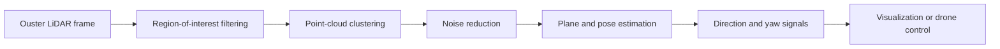
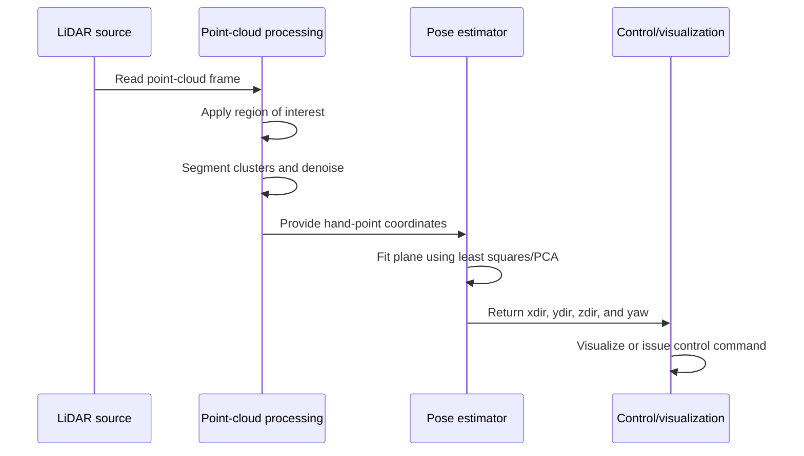

# HandTrackingMATLAB

MATLAB code for extracting hand motion from Ouster LiDAR point clouds and converting the estimated hand pose into directional control signals. The repository contains both an offline playback workflow for recorded sensor data and an optional live workflow that can interface with a Ryze/Tello drone.

> **Project revision:** `v3.0.0`

## Overview

The pipeline estimates hand orientation and displacement from a segmented 3D point cloud:



The hand is modeled as a local plane. Principal directions of the plane are computed from the point-cloud covariance matrix, then converted into relative translational and rotational signals.

## Repository contents

| File | Purpose |
| --- | --- |
| [`recording_control_and_tracking.m`](recording_control_and_tracking.m) | Replays recorded Ouster LiDAR data, estimates hand motion, and visualizes the segmented cloud and fitted plane. |
| [`live_control_and_tracking.m`](live_control_and_tracking.m) | Processes live Ouster LiDAR data and provides an optional Ryze/Tello drone-control interface. |
| [`pointextractor.m`](pointextractor.m) | Filters a point cloud by ROI and retains clustered points that meet the minimum cluster-size threshold. |
| [`affine_fit.m`](affine_fit.m) | Fits a plane to 3D points and returns the plane frame, centroid, relative direction signals, and yaw. |

## Processing workflow



## Requirements

- MATLAB with support for the point-cloud and LiDAR functions used by the scripts, including `pointCloud`, `pcdenoise`, `pcsegdist`, `ousterlidar`, and `ousterFileReader`.
- Ouster OS0-128 sensor metadata in JSON format.
- For offline playback: a recorded Ouster PCAP file and its matching JSON metadata file.
- For live drone control: a compatible Ryze/Tello drone connection and the MATLAB support required by `ryze`, `camera`, `takeoff`, and `land`.

The live script contains commented-out movement commands by default. Review and validate the control behavior in a safe environment before enabling physical drone movement.

## Usage

### Offline playback and visualization

1. Place the recorded `.pcap` and matching `.json` files in the working directory, or update the file paths in `recording_control_and_tracking.m`.
2. Open MATLAB and set the current folder to the repository root.
3. Run:

```matlab
recording_control_and_tracking
```

The script loads the recorded frames, extracts the configured ROI, denoises the selected points, fits a plane, and displays the estimated hand frame.

### Live tracking

1. Connect the Ouster LiDAR and configure the sensor metadata path in `live_control_and_tracking.m`.
2. Connect the Ryze/Tello drone if live drone interaction is required.
3. Verify the ROI, thresholds, coordinate conventions, and safety conditions for the experimental setup.
4. Run:

```matlab
live_control_and_tracking
```

To use the code only for sensing and logging, keep the drone motion commands commented out.

## Continuous integration

This repository includes a GitHub Actions workflow at `.github/workflows/ci.yml` that runs on pull requests and pushes to `main`/`master` and performs:

- Repository checks:
  - GitHub workflow linting with `actionlint`
  - Trailing-whitespace checks for tracked `.m`, `.md`, `.yml`, and `.yaml` files
- MATLAB unit tests from the `tests` folder using `matlab-actions/setup-matlab` and `matlab-actions/run-tests`

### Run tests locally

From the repository root in MATLAB:

```matlab
results = runtests("tests");
assert(all([results.Passed]), "Some tests failed.");
```

The included tests are headless and focus on `affine_fit` behavior that does not require LiDAR hardware, drone hardware, camera access, or live sensor streams.

## Key parameters

The main experimental parameters are defined directly in the scripts:

- **ROI:** spatial bounds used to isolate the expected hand location.
- **Cluster distance:** `0.009` in `pointextractor.m`.
- **Minimum cluster size:** `1000` points in `pointextractor.m`.
- **Motion thresholds:** values used by the control scripts to distinguish meaningful movement from noise.
- **Reference position:** the first valid estimated centroid is used as the displacement reference.

These values are setup-dependent and should be calibrated for the sensor placement, hand distance, sampling configuration, and experimental environment.

## Outputs

`affine_fit` returns:

- `T`: a `3 × 3` estimated hand coordinate frame.
- `p`: the point-cloud centroid.
- `xdir`, `ydir`: relative directional signals derived from the estimated orientation.
- `yaw`: estimated rotation about the relevant axis, in radians.

The scripts use these outputs for visualization and, when explicitly enabled, drone-control commands.

## Experimental notes

- The current implementation assumes that the input points represent a sufficiently dense hand surface and that at least three non-collinear 3D points are available for plane fitting.
- Coordinate signs and ROI limits depend on the LiDAR mounting orientation.
- The recorded-data script expects the PCAP and JSON metadata to describe the same sensor recording.
- No dataset, benchmark results, or formal accuracy claims are included in this repository yet.

## Citation and attribution

If you use this code in research, please cite this repository and include the project revision used in your experiments:

```text
HandTrackingMATLAB, revision v3.0.0.
https://github.com/Robin-Lange/HandTrackingMATLAB
```

## Contact

For questions, reproducibility issues, or collaboration inquiries, open a GitHub issue in this repository.
